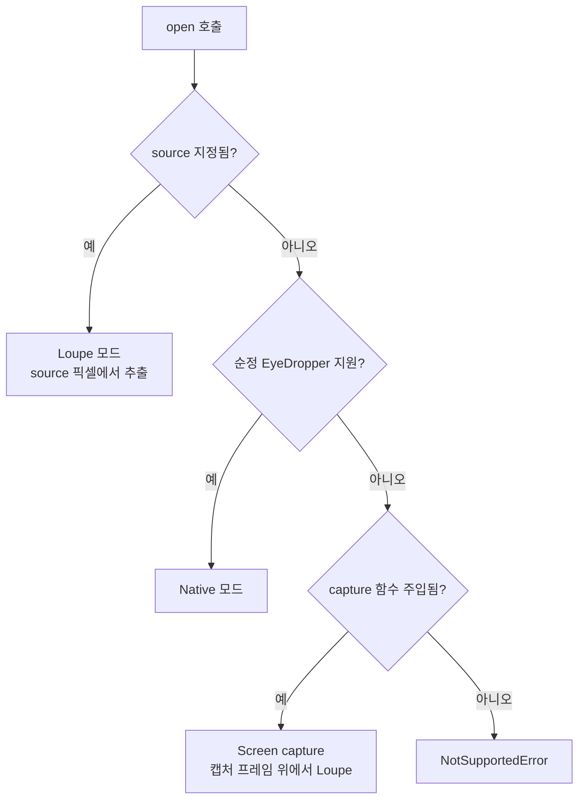
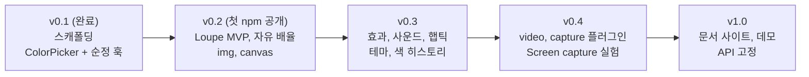

# react-eyedropper-picker 기획서

- 작성일: 2026-11-04
- 수정일: 2026-11-05 (열린 질문 결정 반영, 감성 효과·자유 배율 추가)
- 현재 버전: v0.1.0 (스캐폴딩 완료, 미배포)
- 저장소: https://github.com/momoci99/react-eyedropper-picker

## 1. 개요

**한 줄 정의**: 브라우저 순정 스포이드를 쓸 수 있으면 그대로 쓰고, 쓸 수 없거나 이미지에서 색을 뽑을 때는 픽셀 단위로 정확한 확대경(Loupe)을 제공하는 React 컬러픽커.

**포지셔닝**

> 순정이 되면 순정, 안 되거나 이미지라면 픽셀 정확한 확대경. 확대경 모양, 배율, 효과, 소리까지 마음대로.

기본 컬러픽커 시장은 [react-colorful](https://github.com/omgovich/react-colorful)(주간 약 924만 다운로드)이 차지하고 있다. 기본 픽커만으로는 경쟁할 이유가 약하다. 차별점은 **스포이드 경험**에 둔다. 정확도는 기본이고, 그 위에 **만지는 맛**(드르륵 넘어가는 소리, 딸깍 확정되는 느낌, 원하는 만큼 당겨 보는 배율)을 얹는다.

**개발 동기**

**재미있으니까.**

이 프로젝트는 재미를 위해 만든다. 그래서 우선순위를 정할 때 "써 보면 재미있는가"를 수요 근거와 같은 무게로 본다. 감성 효과(6장)는 사용자 근거가 부족해도 넣는다. 재미가 근거다.

**대상 사용자와 시나리오**

주 사용처는 **이미지에서 색 뽑기**로 확정했다 (2026-11-05).

| # | 누가 | 어떤 화면에서 | 무엇을 |
| --- | --- | --- | --- |
| S1 | 테마 빌더 개발자 | 로고/사진 업로드 화면 | 업로드한 이미지에서 브랜드 색 추출 |
| S2 | 이미지 에디터 개발자 | canvas 편집 화면 | 레이어의 픽셀 색을 정확히 집기, 크게 확대해 경계 픽셀 고르기 |
| S3 | 커머스 개발자 | 상품 이미지 관리 화면 | 상품 사진에서 옵션 색(색상 칩) 추출 |

기본값(배율 8x, 지름 120px)은 S1~S3 공통으로 사진 한 영역을 집는 상황 기준이다. S2처럼 크게 당겨 봐야 하는 경우는 자유 배율(6장)로 해결한다.

**v0.1.0에 이미 있는 것**

| 구성 요소 | 내용 |
| --- | --- |
| `useEyeDropper` | 순정 EyeDropper API 래퍼 ([use-eye-dropper](https://github.com/woofers/use-eye-dropper) TS 재구현, MIT 고지 포함) |
| `useColorPicker` | headless 상태 훅 (HSV 내부 상태, hex 입출력, 화면에서 색 뽑기) |
| `ColorPicker` | 완성형 컴포넌트 (채도/명도 패널, hue 슬라이더, hex 입력, 스포이드 버튼) |
| `SaturationPanel`, `HueSlider`, `EyeDropperButton` | 조합용 부품 컴포넌트, 키보드 조작 지원 |
| 색 변환 유틸 | `normalizeHex`, `hexToRgb`, `rgbToHsv`, `hsvToHex` 등 |
| 빌드/테스트 | pnpm 모노레포, tsdown(ESM + CJS + d.ts, 2026-11-05 tsup에서 교체), vitest 21개 통과 |

## 2. 배경: 순정 EyeDropper API의 한계

순정 API는 `new EyeDropper().open({ signal })` 하나뿐이고, 결과로 `{ sRGBHex }` 하나만 돌려준다.

**순정만 할 수 있는 것**

- 브라우저 밖을 포함한 **화면 전체**에서 색 추출. 웹 코드로는 대체할 방법이 없다.

**순정으로 안 되는 것**

| 항목 | 이유 |
| --- | --- |
| 확대경 커스텀 | 브라우저가 자체 확대경을 그린다. 크기, 배율, 모양 변경 불가 |
| 실시간 미리보기 | 커서가 움직이는 동안의 색을 받을 수 없다. 최종 색만 반환 |
| 애니메이션, 스타일 | 오버레이는 브라우저 UI라 접근 불가 |
| 크로스 브라우저 | Chromium 계열(Chrome, Edge, Opera)만 지원. Firefox, Safari, 대부분의 모바일 미지원 |

**제약**

- 클릭 같은 사용자 동작 안에서만 열 수 있다.
- 보안 컨텍스트(HTTPS) 필요. localhost는 예외.
- 일부 구현은 hex 대신 `rgba(...)` 문자열을 반환한다. (v0.1에서 변환 처리함)

## 3. 경쟁 조사

조사일 2026-11-03. 다운로드는 npm 주간 기준.

| 프로젝트 | 주간 다운로드 | ★ | 방식 | 한계 |
| --- | ---: | ---: | --- | --- |
| [use-eye-dropper](https://github.com/woofers/use-eye-dropper) | 47,113 | 19 | 순정 API React 훅 | 확대경 없음, Chromium 전용 |
| [eyedropper-polyfill](https://github.com/iam-medvedev/eyedropper-polyfill) | 20,738 | 22 | html2canvas-pro로 페이지 캡처 + 확대경, `window.EyeDropper` 폴리필 | 배율 고정(size 4, scale 12), DOM 렌더링 정확도 한계, React용 아님 |
| [@spectrum-web-components/color-loupe](https://www.npmjs.com/package/@spectrum-web-components/color-loupe) | 21,086 | - | Adobe. 손가락/커서 위에 뜨는 색 말풍선 | 픽셀 확대가 아니라 현재 색 미리보기만 |
| [react-eyedrop](https://github.com/jodhman/react-eyedrop) | 5,194 | 25 | html2canvas 기반 React 컴포넌트/훅 | 2024년 이후 갱신 없음, 색 정확도 이슈 다수 |
| [@ltcode/eyedropper](https://www.npmjs.com/package/@ltcode/eyedropper) | 극소 | 1 | canvas/이미지 대상 확대경 (vanilla) | 알파 버전, React 아님, 2025-08 이후 갱신 없음 |
| [react-colorful](https://github.com/omgovich/react-colorful) | 9,240,258 | 3,563 | 기본 컬러픽커 | 스포이드 기능 없음 |

웹 도구 [colortrail](https://colortrail.pages.dev/) 등은 `getDisplayMedia`로 화면 한 프레임을 캡처한 뒤 확대경으로 색을 뽑는다. 라이브러리가 아니라 완성된 앱이지만, 화면 캡처 방식이 실제로 작동함을 보여준다.

**결론**

1. **수요는 있다.** 순정 래퍼와 폴리필을 합쳐 주간 약 7만 다운로드.
   - 단, 이 수치는 **화면 스포이드를 전 브라우저에서 쓰려는 수요**다. Loupe(이미지 확대경) 수요의 직접 근거는 react-eyedrop(주간 5천)과 @ltcode(극소)뿐이다. → Loupe 수요 근거 보강 필요.
   - use-eye-dropper는 ★19에 주간 4.7만으로, 다른 패키지의 의존성으로 딸려 받는 수치일 수 있다. → npm dependents 확인 필요.
2. **DOM을 canvas로 렌더링하는 방식은 정확도가 낮다.** react-eyedrop 사용자들이 계속 부딪혔다 (4장).
3. **이미지/canvas에서 픽셀 정확하게 뽑고, 확대경을 마음대로 꾸밀 수 있는 React 라이브러리는 없다.** 이 자리를 노린다.

## 4. 기존 이슈에서 얻은 인사이트

### html2canvas 방식의 실패 사례 (react-eyedrop)

| 이슈 | 증상 |
| --- | --- |
| [#5](https://github.com/jodhman/react-eyedrop/issues/5) | 회색 배경인데 흰색으로 읽힘 |
| [#21](https://github.com/jodhman/react-eyedrop/issues/21) | 클릭 위치와 다른 곳의 색을 읽음 |
| [#40](https://github.com/jodhman/react-eyedrop/issues/40) | `background-image`는 항상 흰색 |
| [#63](https://github.com/jodhman/react-eyedrop/issues/63) | 모바일 앱 웹뷰 안에서 항상 흰색 |

→ DOM 렌더링 방식은 기본 기능으로 넣지 않는다.

### 기능 아이디어

| 아이디어 | 출처 | 내용 | 반영 시점 |
| --- | --- | --- | --- |
| 샘플링 반경 | react-eyedrop [#2](https://github.com/jodhman/react-eyedrop/issues/2) | 1x1 / 3x3 / 5x5 영역 평균색. 사진 노이즈 대응 | v0.2 |
| 좌표 반환 | react-eyedrop #63 | 결과에 찍은 위치 `x`, `y` 포함 | v0.2 |
| 클릭 차단 | react-eyedrop #84 | 스포이드 모드 중 아래 요소 클릭 이벤트 차단 | v0.2 |
| 커서 커스텀 | react-eyedrop #83 | 스포이드 모드 커서 모양 지정 | v0.3 |
| 순정과 같은 인터페이스 | eyedropper-polyfill | `open({ signal })` → `{ sRGBHex }` 형태 유지, 모드만 교체 | v0.2 |
| 손가락 위 색 말풍선 | Adobe Spectrum color-loupe | 모바일에서 채도 패널 터치 시 손가락 위에 현재 색 표시 | v0.3 |
| 캡처 방식 플러그인 | 폴리필 + getDisplayMedia 사례 | 사용자가 캡처 함수를 주입. 라이브러리는 캡처 구현을 내장하지 않음 | v0.4 |

## 5. 스포이드 모드 설계

| 모드 | 색을 뽑는 곳 | 확대경/효과 커스텀 | 브라우저 | 결정 |
| --- | --- | --- | --- | --- |
| **Native** | 화면 전체 (브라우저 밖 포함) | 불가 | Chromium만 | 유지 |
| **Loupe** | 페이지 안 ``, `<canvas>`, `<video>` | 가능 | 전 브라우저 + 모바일 | **핵심 신규 기능** |
| **Screen capture** | 사용자가 고른 탭/창/화면의 정지 프레임 | 가능 (Loupe 재사용) | 데스크톱 대부분 | 실험 기능 |

### 모드 선택 흐름 (`mode: 'auto'`)



**폴백 UX (결정: 숨김)**: source 없음 + 순정 미지원(Firefox, Safari, 모바일) + capture 없음이면 `NotSupportedError`다. 즉 "전 브라우저 지원"은 source가 있을 때만 성립한다. 이때 `ColorPicker`의 스포이드 버튼은 **숨긴다**. v0.1의 현재 동작과 같다. 못 쓰는 버튼을 보여 주지 않는다.

### Screen capture 모드

`getDisplayMedia`로 한 프레임을 캡처하고, 정지된 화면 위에서 Loupe를 실행한다.

- 장점: 페이지 전체, 다른 창에서도 추출 가능. Firefox, Safari 데스크톱에서도 동작.
- 단점: 매번 권한 팝업과 화면 공유 표시가 뜬다. 모바일은 대부분 미지원.
- 방침: 라이브러리에 내장하지 않고 `capture` 함수를 주입받는 구조로 연다. 사용자가 원하면 html2canvas 계열도 같은 자리에 꽂을 수 있다.

### 하지 않을 것

- **DOM → canvas 렌더링을 기본 기능으로 내장하지 않는다.** 정확도 문제가 4장에서 확인됐고, 번들이 커진다. 필요한 사용자는 `capture` 플러그인으로 직접 연결한다.

## 6. Loupe 기능 명세

### MVP (v0.2)

| 항목 | 명세 |
| --- | --- |
| 대상 | `HTMLImageElement`, `HTMLCanvasElement` |
| 픽셀 읽기 | 오프스크린 canvas에 원본 해상도로 한 번 그리고 `getImageData` 결과 캐시 (`willReadFrequently: true`) |
| 확대 | 배율 기본 8x. 확대 렌더링은 `imageSmoothingEnabled = false`. 자세한 내용은 아래 "자유 배율" |
| 배율 조절 | 휠, 핀치, `+`/`-` 키로 열린 상태에서 배율 변경 |
| 그리드 | 픽셀 경계선 on/off. 한 칸이 4px 미만이면 자동으로 숨김 |
| 중앙 표시 | 중앙 픽셀 테두리 강조 + 현재 색 라벨 (hex) |
| 모양 | 원형 / 사각형 |
| 크기 | 확대경 지름 옵션 (기본 120px) |
| 샘플링 반경 | `1` / `3` / `5` (NxN 평균) |
| 좌표 | 결과에 원본 이미지 기준 `x`, `y` 포함 |
| 마우스 | 이동 시 확대경 추적, 클릭으로 확정 |
| 터치 | 손가락 위쪽으로 확대경 오프셋, 손 뗄 때 확정 |
| 키보드 | 방향키 1px 이동, Shift+방향키 10px, Enter 확정, Esc 취소 |
| 취소 | `AbortSignal`, Esc, 대상 밖 클릭 → `AbortError` |
| 클릭 차단 | 스포이드 모드 중 오버레이가 포인터 이벤트를 가로챔 |
| 이벤트 | 중앙 픽셀 변경, 배율 변경, 열림/확정/취소 이벤트를 내보냄. v0.3 사운드가 여기에 붙는다 |

### 자유 배율 (v0.2, 필수)

배율은 **사용자가 마음껏** 정한다. 고정 배율이 경쟁 라이브러리의 한계였다 (eyedropper-polyfill은 12배 고정).

| 항목 | 명세 |
| --- | --- |
| 값 | 1 이상 아무 숫자. 소수 허용 (예: 2.5, 13) |
| 범위 | 기본 1~64. `minMagnification` / `maxMagnification`로 넓히거나 좁힘. 라이브러리가 정한 상한은 없음 |
| 제어 | `magnification`(제어) + `onMagnificationChange`, 또는 `defaultMagnification`(비제어) |
| 휠 | 한 칸에 ×1.1(연속). `magnificationSteps`를 주면 그 값들 사이를 한 칸씩 이동 (예: `[2, 4, 8, 16, 32]`) |
| 핀치 | 두 손가락 거리 비율만큼 연속 변경 |
| 키보드 | `+` / `-`로 한 단계, `0`으로 기본 배율 복귀 |
| 소수 배율 렌더링 | 칸 경계를 `Math.round(i * m)`으로 계산. 칸 크기가 1px씩 다를 수 있지만 그리드와 칸이 항상 맞물리고, 중앙 픽셀은 항상 정중앙에 온다 |
| 표시 | 배율이 바뀌는 동안 확대경 아래에 현재 배율(예: `12.5×`)을 잠깐 표시 |

### 효과와 감성 (v0.3, 필수)

개발 동기(1장)가 "재미"이므로 효과는 미루지 않는다. 시각 효과와 함께 **소리와 손맛**을 강조한다.

**시각 효과**

| 항목 | 명세 |
| --- | --- |
| 부드러운 추적 | 확대경이 커서를 보간(lerp)으로 따라감. 강도 옵션 |
| 열림/닫힘 | 확대경이 커지며 등장, 줄어들며 사라짐 |
| 확정 연출 | 확정 시 색이 대상 스와치 쪽으로 이동하는 연출 (선택) |
| 색 라벨 전환 | 색 변경 시 라벨 배경 전환 애니메이션 |
| 배율 전환 | 배율 변경 시 확대 화면이 부드럽게 줌 |
| 틱 연동 | 틱 소리와 맞춰 중앙 칸 테두리가 짧게 반짝임 (선택) |
| 모션 감소 | `prefers-reduced-motion`이면 보간과 애니메이션 끔 |

**소리와 손맛**

확대경을 움직일 때 기계식 다이얼처럼 **드르륵** 넘어가는 소리를 낸다.

| 순간 | 소리 | 규칙 |
| --- | --- | --- |
| 픽셀 이동 | 짧은 틱 | 중앙 픽셀(원본 기준)이 바뀔 때마다 한 번. 배율이 높으면 "딸깍… 딸깍", 빠르게 훑으면 "드르르륵" |
| 배율 변경 | 디텐트 틱 (픽셀 틱과 다른 음색) | 배율 한 단계(또는 ×1.1)마다 한 번 |
| 열림 | 짧은 "슉" | 스포이드가 열릴 때 |
| 확정 | 또렷한 "딸깍" | 색 확정 시 |
| 취소 | 낮은 톤 | Esc, 대상 밖 클릭 |

- **드르륵 질감**: 틱 사이 최소 간격(기본 35ms)보다 빠르면 합쳐서 한 번만 낸다. 천천히 움직이면 또렷한 딸깍, 빠르게 훑으면 음량을 줄이고 음높이를 살짝 올려 거슬리지 않는 "드르륵"이 되게 하고, 틱마다 음높이를 ±5% 흔들어 단조로움을 없앤다.
- **구현**: Web Audio API로 소리를 합성한다. 오디오 파일이 없으니 번들이 작고 네트워크 요청도 없다.
- **자동재생 정책**: `AudioContext`는 `open()`(사용자 동작) 안에서 만들거나 `resume()`한다.
- **커스텀**: 음량, 이벤트별 on/off, 이벤트별 재생 함수 주입(직접 만든 소리나 `AudioBuffer` 사용) 지원.
- **햅틱**: `navigator.vibrate`로 픽셀 틱과 확정에 짧은 진동. Android Chrome에서 동작하고, 지원하지 않는 브라우저(iOS Safari 등)에서는 조용히 무시한다.
- **기본값**: 라이브러리 기본은 **꺼짐**(`sound: false`, `haptics: false`). 앱에서 갑자기 소리가 나면 안 되기 때문이다. 옵션 한 줄로 켠다. **데모는 켜진 상태**로 보여 준다.
- 탭이 숨겨지면(`visibilitychange`) 소리를 멈춘다.

### 렌더링 원칙

- 그리기는 `requestAnimationFrame` 안에서만. 포인터 이벤트에서는 좌표만 저장.
- 확대경은 별도 canvas 하나에 그린다. DOM 노드를 픽셀마다 만들지 않는다.
- `devicePixelRatio`를 반영해 확대경 canvas를 고해상도로 그린다.
- 배율이 높을수록 그릴 원본 픽셀 수는 줄어든다 (지름 120px, 64배면 약 2x2 픽셀). 배율과 관계없이 그리는 비용은 확대경 canvas 크기로 정해진다.

## 7. API 초안

확정 전 초안이다. 훅 구조는 **A안(훅 둘)**으로 결정했다 (2026-11-05). 기본 경로에 Loupe 코드가 들어가지 않는다.

### 훅

```ts
// ── react-eyedropper-picker (기본 경로): 순정 전용 ──
type PickResult = {
  sRGBHex: string               // 순정 API와 같은 키
  x?: number                    // Loupe 모드일 때 원본 픽셀 좌표
  y?: number
  mode: 'native' | 'loupe'
}

declare function useEyeDropper(): {
  open: (opts?: { signal?: AbortSignal }) => Promise<PickResult>
  close: () => void
  isSupported: boolean          // 순정 EyeDropper 지원 여부 (v0.1과 같은 의미)
  isOpen: boolean
}

// ── react-eyedropper-picker/loupe: auto / loupe 지원 ──
type PickMode = 'auto' | 'native' | 'loupe'

type PickSource = HTMLImageElement | HTMLCanvasElement | HTMLVideoElement

type LoupeSoundEvent = 'pixel' | 'zoom' | 'open' | 'confirm' | 'cancel'

type LoupeSoundOptions = {
  volume?: number               // 0~1, 기본 0.5
  events?: Partial<Record<LoupeSoundEvent, boolean>>   // 이벤트별 on/off
  minTickInterval?: number      // ms, 기본 35. 이보다 빠른 틱은 합침
  play?: Partial<Record<LoupeSoundEvent, (ctx: AudioContext, speed: number, output: AudioNode) => void>>  // 직접 만든 소리. output에 연결해야 volume이 적용됨
}

type LoupeOptions = {
  // 자유 배율 (v0.2)
  magnification?: number        // 제어 모드
  defaultMagnification?: number // 비제어 모드, 기본 8
  minMagnification?: number     // 기본 1
  maxMagnification?: number     // 기본 64, 상한 없음
  magnificationSteps?: number[] // 주면 휠/키가 이 값들 사이를 이동
  onMagnificationChange?: (value: number) => void

  size?: number                 // 확대경 지름 px, 기본 120
  shape?: 'circle' | 'square'   // 기본 'circle'
  grid?: boolean                // 기본 true (칸 4px 미만이면 자동 숨김)
  sampleSize?: 1 | 3 | 5        // 기본 1
  className?: string
  renderLabel?: (color: PickResult) => React.ReactNode

  // 효과와 감성 (v0.3)
  smoothing?: number            // 0~1 추적 보간, 0이면 즉시
  animate?: boolean             // 기본 true. 등장/퇴장, 배율 전환 애니메이션
  sound?: boolean | LoupeSoundOptions   // 기본 false
  haptics?: boolean             // 기본 false
}

type UseLoupeEyeDropperOptions = {
  mode?: PickMode               // 기본 'auto'
  source?: PickSource | React.RefObject<PickSource>   // open()에서 덮어쓸 수 있음
  loupe?: LoupeOptions
  capture?: () => Promise<HTMLCanvasElement | ImageBitmap>  // v0.4
}

declare function useLoupeEyeDropper(options?: UseLoupeEyeDropperOptions): {
  open: (opts?: { source?: PickSource; signal?: AbortSignal }) => Promise<PickResult>
  close: () => void
  isSupported: boolean          // 현재 모드 기준 사용 가능 여부
  isOpen: boolean
}
```

- 기본 경로 `useEyeDropper()`는 v0.1과 같은 사용법을 유지한다.
- Loupe 훅은 확대경을 `document.body`에 plain DOM overlay로 그린다 (2026-11-05 결정). `react-dom` peer 없이 위 반환값 그대로 유지한다. 그래서 `renderLabel`(ReactNode)은 훅이 아니라 `ImageColorPicker`에서 지원하고, 훅은 hex 텍스트 라벨을 쓴다.
- `ImageColorPicker` 결정 (2026-11-06):
  - `renderLabel`은 `createPortal`로 확대경 라벨 자리에 그린다. 그래서 `react-dom`을 peer(`>=19.2`)로 둔다. 기본 경로는 `react-dom`을 import하지 않는다.
  - 조작은 hover 즉시 확대다. overlay 없이 마우스를 올리면 확대경이 따라오고, 클릭할 때마다 뽑는다. 터치는 이미지 위에서 누르고 끌다가 떼면 뽑는다(이미지 위 스크롤은 막힘). 키보드는 이미지에 focus 후 Enter/Space로 기존 full-screen loupe를 연다.
  - 휠 확대는 확대경이 보일 때(이미지 위)만 동작한다. 다른 곳에서는 페이지가 스크롤된다.
- `isSupported` 의미: 기본 훅은 "순정 지원 여부", Loupe 훅은 "현재 모드 기준". 훅이 나뉘어 의미가 섞이지 않는다.
- `open()` 실패는 순정 API와 같은 방식(`AbortError`, `NotSupportedError`)으로 reject한다.
  - 현재 v0.1 코드는 미지원 시 일반 `Error`를 던진다. v0.2에서 `DOMException('...', 'NotSupportedError')`로 바꾼다. 미배포라 호환성 부담 없음.
- `mode: 'auto'`에서 순정이 지원되더라도 `source`가 있으면 Loupe를 쓴다. source를 줬다는 것은 그 대상에서 뽑겠다는 뜻이다.

### 컴포넌트

```tsx
// 이미지에서 색 뽑기 (react-eyedropper-picker/loupe)
<ImageColorPicker
  src="/photo.jpg"
  onPick={({ sRGBHex, x, y }) => {}}
  loupe={{
    defaultMagnification: 10,
    maxMagnification: 128,
    sampleSize: 3,
    sound: true,
    haptics: true,
  }}
/>

// 기존 ColorPicker에 Loupe 스포이드 연결
// ColorPicker는 { open, isSupported } 모양의 객체만 받으므로 기본 경로에 Loupe 코드가 들어가지 않는다.
const dropper = useLoupeEyeDropper({ source: imgRef, loupe: { sound: true } })
<ColorPicker value={color} onChange={setColor} eyeDropper={dropper} />
```

- `eyeDropper`를 안 주면 기본 경로 `useEyeDropper()`(순정)를 쓴다.
- `eyeDropper.isSupported`가 false면 스포이드 버튼을 숨긴다 (5장 폴백 UX).
- 구현 (2026-11-06): 기본 경로에 구조 타입 `EyeDropperLike = { open(): Promise<{ sRGBHex }>, isSupported }`를 둔다. `useColorPicker({ eyeDropper })`도 같은 옵션을 받는다. 커스텀 `eyeDropper`일 때 버튼 이름은 "Pick a color"다 (화면 전체가 아니므로).

### 패키지 경로 분리

```
react-eyedropper-picker          # ColorPicker, 부품, useColorPicker, useEyeDropper(native), 유틸
react-eyedropper-picker/loupe    # Loupe 엔진, useLoupeEyeDropper, ImageColorPicker, 사운드
```

기본 경로만 쓰는 사용자의 번들에 Loupe 코드가 들어가지 않게 한다.

## 8. 위험 요소와 대응

| 위험 | 내용 | 대응 |
| --- | --- | --- |
| 번들 크기 | Loupe와 효과 코드로 기본 픽커가 무거워질 수 있음 | `/loupe` 서브 경로 분리, `sideEffects: false` 유지, 크기 예산을 CI에서 측정 |
| CORS | 다른 도메인 이미지는 canvas가 오염되어 `getImageData` 실패 | `crossOrigin="anonymous"` 안내, 오염 감지 시 명확한 에러 메시지와 문서 |
| 성능 | 큰 이미지에서 매 프레임 읽기/그리기 비용 | 픽셀 데이터 1회 캐시, rAF 안에서만 그리기, 확대 영역만 그리기 |
| 고해상도 화면 | 레티나에서 CSS 좌표와 원본 픽셀 좌표 불일치 | 표시 크기 대비 원본 크기 비율로 좌표 변환, 테스트 케이스 작성 |
| 색공간 | display-p3 이미지가 sRGB canvas로 변환되며 값이 달라질 수 있음 | 1차는 sRGB 고정 후 문서화. `colorSpace` 옵션은 추후 검토 |
| `<video>` | 프레임이 계속 바뀜 | 스포이드를 열 때 현재 프레임을 고정해서 사용 (v0.4) |
| 접근성 | 마우스 전용이 되기 쉬움 | 키보드 조작, 포커스 이동, `aria-live`로 현재 색 읽기, 모션 감소 대응 |
| 터치 | 손가락이 대상을 가림 | 확대경 오프셋, 확정 방식(손 뗄 때) 명시 |
| 사운드 거부감 | 앱에서 갑자기 소리가 나면 사용자가 불쾌해함 | 기본 꺼짐, 음량 옵션, 이벤트별 끄기, 탭 숨김 시 정지 |
| 자동재생 정책 | 사용자 동작 없이 만든 `AudioContext`는 소리가 안 남 | `open()`(사용자 동작) 안에서 생성/resume |
| 틱 과다 | 빠르게 훑으면 틱이 수백 번 겹쳐 시끄러움 | 최소 간격(35ms) 안의 틱은 합침, 빠를수록 작게, 동시 재생 수 제한 |
| 자유 배율 | 소수 배율에서 칸 크기가 들쭉날쭉해 그리드가 어긋날 수 있음 | 칸 경계를 반올림 계산으로 고정, 중앙 픽셀은 항상 정중앙 |

## 9. 로드맵



| 버전 | 범위 | 완료 조건 |
| --- | --- | --- |
| v0.1 | 프로젝트 구조, ColorPicker, 순정 훅, 테스트 | 완료 (미배포) |
| v0.2 | Loupe 엔진, `useLoupeEyeDropper`, `ImageColorPicker`, 확대/그리드/샘플링/좌표, **자유 배율**(휠·핀치·키보드, min/max/steps), 키보드, 터치, Loupe 이벤트, `/loupe` 경로, `ColorPicker`의 `eyeDropper` prop, GitHub Pages 데모, `package.json` description 갱신, **첫 npm 공개** | jsdom 단위 테스트 + 실제 브라우저(Chrome, Firefox, Safari, 모바일 Safari) 수동 확인 + 데모 공개 + npm 배포 |
| v0.3 | 부드러운 추적, 등장/확정 애니메이션, 배율 전환 애니메이션, **사운드(드르륵 틱, 확정 딸깍), 햅틱**, CSS 변수 테마, 다크 모드, 색 히스토리(근거 보강 필요), 손가락 위 색 말풍선 | 모션 감소 대응 확인, 데모에서 효과와 소리 시연(데모는 소리 켠 상태), Android 진동 확인 |
| v0.4 | `<video>` 대상, `capture` 플러그인 구조, `getDisplayMedia` 예제 | 플러그인으로 html2canvas와 getDisplayMedia 둘 다 연결되는 예제 |
| v1.0 | 문서 사이트, GitHub Pages 데모, API 고정, 번들 크기 예산 | semver 1.0 공개 |

CI(GitHub Actions: 테스트, 타입체크, 빌드)는 v0.2 작업 시작 전에 추가한다.

- v0.1은 npm에 내지 않는다. v0.2(Loupe + 데모)를 첫 공개로 한다. 2026-11-05 기준 npm에 `react-eyedropper-picker` 이름이 비어 있어 선점이 급하지 않다.
- 데모는 v1.0이 아니라 v0.2 공개와 함께 낸다. 확대경은 직접 봐야 가치가 전달된다. v1.0은 문서 사이트를 정식화한다.
- 버전별 목표 시점: TBD. 투입 가능 시간을 기준으로 정한다.

### 성공 지표 (수치 TBD)

| 지표 | 목표 | 측정 시점 |
| --- | --- | --- |
| 픽셀 정확도 | 테스트 이미지 세트 기준 오차 0 | v0.2 |
| `/loupe` 번들 크기 | gzip N KB 이하 | v0.2부터 CI |
| 기본 경로 번들 크기 | gzip N KB 이하, v0.1 대비 증가 없음 | v0.2부터 CI |
| 지원 브라우저 | Chrome, Firefox, Safari, iOS Safari, Android Chrome 수동 확인 통과 | 매 릴리스 |
| 채택 | 주간 다운로드 N, ★ N | v1.0 |

## 10. 테스트 전략

- **단위 테스트(vitest + jsdom)**: 색 변환, 샘플링 평균 계산, 좌표 변환, 모드 선택 로직, 키보드 조작, 배율 계산(범위 제한, steps 이동, 휠/핀치 비율, 소수 배율 칸 경계), 틱 스케줄링(픽셀 변경 시 1회, 최소 간격 내 합침). Web Audio는 mock으로 호출 여부만 확인.
- **소리 확인**: 소리 질감(드르륵 느낌)은 자동 테스트로 판단할 수 없다. 데모에서 직접 들어 보고 조정한다.
- **브라우저 테스트**: jsdom에는 canvas 픽셀 읽기가 없다. Loupe 렌더링은 Vitest Browser Mode 또는 Playwright로 실제 브라우저에서 검증한다.
- **수동 확인 목록**: Chrome, Firefox, Safari 데스크톱, iOS Safari, Android Chrome에서 확대경 위치, 터치 확정, 레티나 좌표.

## 11. 열린 질문

### 결정됨 (2026-11-05)

- [x] 주 사용처: **이미지에서 색 뽑기**로 확정. 1장 대상 사용자 표 채움.
- [x] 훅 구조: **A안**. 기본 경로 `useEyeDropper`는 순정 전용, `/loupe`가 `useLoupeEyeDropper` 제공 (7장).
- [x] 폴백 UX: 순정 미지원 + source 없음이면 스포이드 버튼 **숨김** (5장).
- [x] 패키지 이름: `react-eyedropper-picker` **유지**. `package.json` description은 v0.2 공개 때 갱신.
- [x] 첫 공개 버전: **v0.2**(Loupe + 데모). v0.1은 npm에 내지 않음.
- [x] `mode: 'auto'`에서 순정 지원 + `source` 지정 시: **Loupe 우선**.
- [x] 컴포넌트 이름: **`ImageColorPicker`** (주 사용처가 이미지이므로).
- [x] v0.2 범위 축소: **안 함**. 터치 최적화와 샘플링 반경 모두 v0.2에 포함.
- [x] 효과 우선순위: **미루지 않음**. 개발 동기가 "재미"이므로 v0.3에 효과와 사운드를 넣는다.
- [x] 추가 필수 기능: **확대경 감성 효과**(드르륵 틱 소리, 확정 딸깍, 햅틱, v0.3)와 **자유 배율**(v0.2) (6장).
- [x] 사운드 기본값: 라이브러리 **꺼짐**, 데모 **켜짐**.

### 후순위

- [ ] 알파 채널(투명도) 지원을 v0.3에 넣을 것인가?
- [ ] React 외 프레임워크 지원을 위해 Loupe 엔진을 프레임워크 독립 코어로 분리할 것인가?

## 12. 참고 자료

- [MDN: EyeDropper API](https://developer.mozilla.org/en-US/docs/Web/API/EyeDropper_API)
- [use-eye-dropper](https://github.com/woofers/use-eye-dropper)
- [eyedropper-polyfill](https://github.com/iam-medvedev/eyedropper-polyfill)
- [react-eyedrop](https://github.com/jodhman/react-eyedrop)
- [@spectrum-web-components/color-loupe](https://www.npmjs.com/package/@spectrum-web-components/color-loupe)
- [@ltcode/eyedropper](https://www.npmjs.com/package/@ltcode/eyedropper)
- [react-colorful](https://github.com/omgovich/react-colorful)
- [Choi-R/color-identifier](https://github.com/Choi-R/color-identifier) (vanilla JS 확대경 참고 코드)
- [colortrail](https://colortrail.pages.dev/) (getDisplayMedia 기반 화면 색 추출 도구)
- [Polypane: The EyeDropper API](https://polypane.app/blog/the-eyedropper-api-pick-colors-from-anywhere-on-your-screen/)
